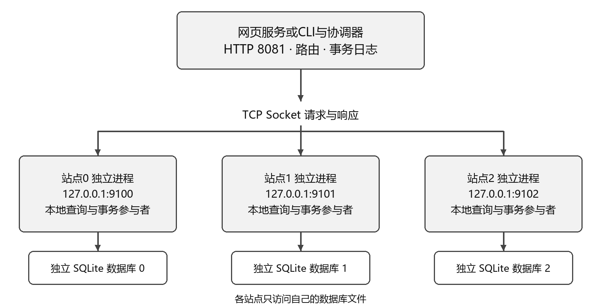

# 2 总体架构设计

## 2.1 架构组成

系统由一个协调器进程（网页服务或CLI入口）和三个数据站点进程构成，共四个进程。协调器负责业务编排、站点定位、全局事务决定及结果汇总；站点负责本地查询、准备记录、业务变更和本地恢复。协调器通过TCP Socket调用站点的数据接口。

图2.1 系统架构与进程划分

| 组件 | 核心职责 | 持久化内容 |
| --- | --- | --- |
| 网页服务或CLI与协调器 | 参数校验、业务请求串行化、状态展示 | 协调器身份与全局JSONL事件日志 |
| 路由模块 | 根据整数ID定位站点、整理参与者集合 | 固定站点配置 |
| Socket客户端 | 消息编码、超时处理、按原标识重试 | 无独立业务数据 |
| 数据站点 | 白名单接口、本地事务、待执行操作与逻辑锁 | 独立SQLite数据库 |
| 恢复模块 | 重放全局决定、查询参与者状态、控制业务入口 | 沿用全局日志和本地事务表 |

## 2.2 模块职责与小组分工

| 负责人 | 模块或文件 | 负责内容 |
| --- | --- | --- |
| 同学A | router.py | 分片路由、目标站点与参与者计算 |
| 同学A | transaction.py | Socket客户端调用、全局2PC协调、全局事件日志 |
| 同学A | recovery.py | 全局日志重放、决定重发、系统访问门禁 |
| 同学B | init_db.py | 三站点建表、静态目录复制、初始一致数据导入 |
| 同学B | node_server.py | TCP监听、协议校验、白名单请求分发 |
| 同学B | storage.py | 本地查询、持久化准备、幂等提交与中止 |
| 同学B | main.py | CLI输入输出、参数处理、请求ID保留 |
| 同学B | auth.py、web_server.py、web目录 | 登录会话、网页权限与交互 |
| 同学C | 设计文档与验证脚本 | 接口契约整理、功能联调、故障恢复检查及文档维护 |

A与B先共同确定第5章接口及第6章事务状态，再分别实现协调器与参与者。C维护接口版本和验证清单，A、B提供各自模块的处理流程。公共模块protocol.py统一完成Socket消息编解码。

## 2.3 单机部署

| 进程 | 监听地址 | 本地数据 |
| --- | --- | --- |
| 协调器 | 网页模式127.0.0.1:8081；CLI通过终端操作 | data/coordinator/global.jsonl |
| 站点0 | 127.0.0.1:9100 | data/node0/node.db |
| 站点1 | 127.0.0.1:9101 | data/node1/node.db |
| 站点2 | 127.0.0.1:9102 | data/node2/node.db |

站点编号固定为0、1、2。启动时核对站点编号、集群标识和数据集版本。各站点管理所属数据库，全局日志保留在协调器本地。

## 2.4 配置与多机迁移

配置文件维护cluster_id、dataset_version、node_count、各站点host与port、data_dir数据根目录及网络超时。node_count固定为3，整数ID通过id mod 3计算所属站点。

多机部署时，每台主机运行一个数据站点，保留该站点原数据库与编号；协调器将host改为各主机可达地址，站点监听相应网卡。协调器通过配置中的地址访问站点，协议和路由规则保持一致。

系统部署在本机或教学局域网中。迁移时先停止业务并完成未决事务，再搬移数据库文件、修改地址并启动站点。

## 2.5 运行状态

| 状态 | 进入条件 | 允许操作 |
| --- | --- | --- |
| STARTING | 协调器启动并取得独占锁 | 本地状态显示 |
| RECOVERING | 重放日志或收敛未决事务 | 状态查看、恢复重试 |
| READY | 无未决事务且初始化检查通过 | 顺序接纳业务读写 |
| BUSY | 正在执行一个业务请求 | 当前请求与状态显示 |
| BLOCKED | 日志异常或未决事务无法收敛 | 诊断与恢复重试 |

事务决定已持久化且参与者确认完成后，协调器由BUSY回到READY。

## 2.6 数据访问与恢复

站点服务器通过固定业务接口处理请求。写操作由协调器编排，各站点进程访问所属数据库。SQLite本地事务负责单库原子更新，应用层两阶段协议负责跨站点事务协调。[1]

三个站点分别保存学生与名额的分片，并各自保存完整静态课程目录。课程目录副本服务于本地连接。协调器重启后读取全局日志，数据站点重启后读取本地事务状态，双方依据原事务决定完成恢复。

参考资料：[1] [SQLite事务说明](https://www.sqlite.org/lang_transaction.html)。

## 2.7 网页客户端与角色

网页模式将HTTP服务与协调器部署在同一进程，浏览器通过8081端口访问。auth.py维护演示账号和会话，web_server.py校验学生身份及管理员权限，web目录负责黑白灰页面。CLI与网页复用同一Coordinator类。学生使用本人选退课入口，管理员使用名单、操作记录及恢复入口。
