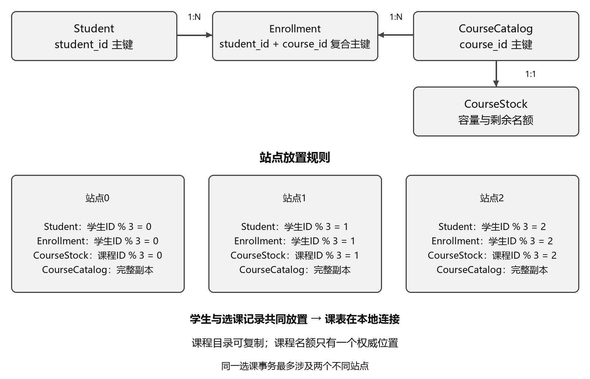

# 3 数据库与数据分布设计

## 3.1 逻辑数据模型

业务模型由Student、CourseCatalog、Enrollment和CourseStock四个关系构成。Student与CourseCatalog之间通过Enrollment形成多对多关系；CourseStock与CourseCatalog按课程ID一一对应。将课程静态属性与可变名额分开，可以在复制课程名称和学分的同时，为名额保留唯一写入位置。



图3.1 业务关系与数据放置

## 3.2 学生与课程目录

| 表 | 字段 | SQLite类型 | 约束与含义 |
| --- | --- | --- | --- |
| Student | student_id | INTEGER | 主键，正整数 |
| Student | name | TEXT | 非空，学生姓名 |
| Student | department | TEXT | 非空，院系名称 |
| CourseCatalog | course_id | INTEGER | 主键，正整数 |
| CourseCatalog | course_name | TEXT | 非空，课程名称 |
| CourseCatalog | credits | INTEGER | 非空，大于0 |

Student共10000条，按学生ID分配到对应站点。CourseCatalog共1000条，在三个站点各保存完整副本。目录由初始化程序写入，业务期间只读。

## 3.3 选课记录与课程名额

| 表 | 字段 | SQLite类型 | 约束与含义 |
| --- | --- | --- | --- |
| Enrollment | student_id | INTEGER | 复合主键；本地外键引用Student |
| Enrollment | course_id | INTEGER | 复合主键；本地外键引用CourseCatalog |
| Enrollment | enrolled_at | TEXT | 非空，UTC时间字符串 |
| CourseStock | course_id | INTEGER | 主键；本地外键引用CourseCatalog |
| CourseStock | capacity | INTEGER | 非空，大于等于0 |
| CourseStock | remaining | INTEGER | 非空，0至capacity之间 |

Enrollment以(student_id, course_id)为复合主键，确定每条选课记录的唯一性。主键索引支持按学生查询课表，另建course_id索引支持课程选课记录的检查与汇总。CourseStock由课程ID所属站点保存，remaining随选退课事务更新。

所有站点连接启用PRAGMA foreign_keys=ON。Enrollment的两类外键在学生站点均有本地父表，由SQLite校验引用关系；跨站点名额与选课数量通过初始化规则和事务协议维护。[1]

## 3.4 分片规则与分配

设站点集合为{0,1,2}，id为正整数，定义h(id)=id mod 3。

```text
Student_i     = Student中满足student_id mod 3 = i的记录
Enrollment_i  = Enrollment中满足student_id mod 3 = i的记录
CourseStock_i = CourseStock中满足course_id mod 3 = i的记录
CourseCatalog_i = 完整CourseCatalog
```

对每个非复制关系，每条记录恰好满足一个余数条件，因此分片完整且互斥；对三个片段做UNION ALL可重构原关系。CourseCatalog属于全复制关系，读取时选择一个有效副本。

Student与Enrollment使用相同分片键和站点映射；任何可连接的学生和选课记录均在同一站点，满足本设计采用的站点依赖条件。CourseStock按课程ID分片，与学生分片独立，选课事务最多涉及两个不同站点。

| 数据 | 全局规模 | 站点0 | 站点1 | 站点2 |
| --- | --- | --- | --- | --- |
| Student | 10000条 | 按学生ID分片 | 按学生ID分片 | 按学生ID分片 |
| Enrollment | 根据选课关系生成 | 按学生所属分片 | 按学生所属分片 | 按学生所属分片 |
| CourseCatalog | 1000条逻辑记录 | 完整1000条 | 完整1000条 | 完整1000条 |
| CourseStock | 1000条 | 按课程ID分片 | 按课程ID分片 | 按课程ID分片 |

Student与CourseStock的分布由对应ID的取模结果确定，Enrollment随学生分片放置。课程目录共1000条逻辑记录，三个副本合计保存3000条。

## 3.5 分布示例

学生1001归属站点2，课程100归属站点1。该学生选修课程100时，站点2负责新增Enrollment(1001,100)，站点1负责将课程100的remaining减一；其课表查询在站点2连接本地课程目录即可。

学生1选修课程4时，学生站点与名额站点均为站点1。协调器将两项操作打包成同一参与者请求，站点在一个本地事务中提交，仍保留全局请求ID和事务记录以支持重试。

## 3.6 事务辅助数据

| 表 | 主键与字段 | 用途 |
| --- | --- | --- |
| LocalTransaction | tx_id主键；request_id、payload_digest、state、updated_at | 保存PREPARED、COMMITTED或ABORTED及请求摘要 |
| PendingOperation | (tx_id, seq)主键；op_type、student_id、course_id、enrolled_at | 保存尚未执行的确定性业务意图 |
| ResourceLock | resource_key主键；tx_id | 保存事务对选课记录或名额的逻辑独占权 |

resource_key采用enrollment:学生ID:课程ID或stock:课程ID。tx_id引用LocalTransaction，PendingOperation按序号排列。请求摘要取规范化UTF-8 JSON的SHA-256值，用于核对同一tx_id对应的操作内容。

准备阶段将待执行意图与事务状态写入辅助表；业务表在提交阶段更新。提交阶段在同一个SQLite事务内执行待执行操作、修改LocalTransaction状态并清理对应意图和锁；中止阶段原子清理意图和锁并记录ABORTED。终态事务记录持续保留，供请求重试和恢复查询使用。

数据库采用journal_mode=DELETE、synchronous=FULL，并使用短时BEGIN IMMEDIATE事务修改本地状态。[2]

## 3.7 初始化与数据维护

初始化先构造全局一致数据，再按规则写入各站点：生成学生和课程目录，按学生ID确定初始课程集合，计算各课程已选人数，容量取100与最大已选人数加10中的较大值，最后设置remaining=capacity-已选人数。选课记录与remaining由同一初始选课集合计算生成。

新集群通过初始化程序建表并导入数据。协调器启动时核对可达站点的目录版本和摘要，并按第6章恢复事务；未决事务收敛后进入READY。

参考资料：[1] [SQLite外键约束](https://www.sqlite.org/foreignkeys.html)；[2] [SQLite PRAGMA说明](https://www.sqlite.org/pragma.html)。
