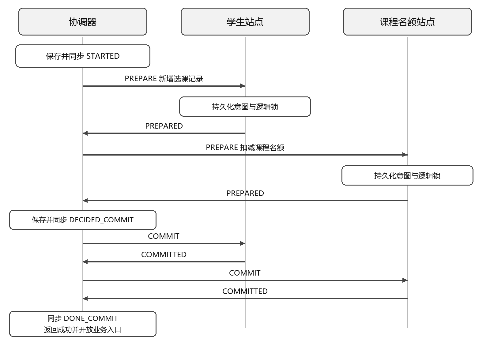

# 6 事务与故障恢复设计

## 6.1 事务模型

一次选课包含新增选课记录与扣减课程名额，一次退课包含删除选课记录与增加名额。学生站点和名额站点不同时，必须通过全局协议协调；相同时，两项操作由一个参与者在本地原子执行。

系统通过应用层两阶段提交协议协调业务：准备阶段持久化业务意图与逻辑锁，提交阶段依据全局决定，在各参与者的SQLite本地事务中执行意图。[1]

一个协调器统一处理业务读写，任一时刻最多执行一个未决写事务。目录与容量在运行期保持固定，各站点通过逻辑锁管理待执行操作，并持久化事务状态。恢复时读取协调器日志及各站点数据库，继续完成全局决定。

## 6.2 状态与转换

| 角色 | 事务状态 | 含义 |
| --- | --- | --- |
| 协调器 | STARTED → DECIDED_COMMIT → DONE_COMMIT | 所有参与者准备成功，决定提交并收齐确认 |
| 协调器 | STARTED → DECIDED_ABORT → DONE_ABORT | 决定中止并收齐确认 |
| 参与者 | UNKNOWN → PREPARED → COMMITTED | 已持久化意图，随后应用业务变更 |
| 参与者 | UNKNOWN或PREPARED → ABORTED | 保持业务数据原值，清理意图与锁 |

全局决定持久化后保持固定。PREPARED表示意图与逻辑锁已保存；协调器收齐提交确认后向用户返回成功。决定未知或等待超时时，参与者保留PREPARED状态，等待协调器恢复；终态参与者对相反决定返回TX_CONFLICT。



图6.1 跨站点选课的准备与提交流程

## 6.3 准备阶段

协调器接纳请求后关闭业务入口，生成tx_id，计算参与者和各自操作列表。先写入并同步STARTED事件，事件包含request_id、actor、固定业务参数、参与者和完整操作；每次PREPARE携带对应操作的payload_digest，同步成功后发送PREPARE。

参与者在一个BEGIN IMMEDIATE本地事务中完成以下步骤：校验事务标识与摘要，检查本地数据及操作归属，获取资源逻辑锁，写入LocalTransaction和PendingOperation，最后提交本地事务。本地持久化完成后返回PREPARED，Enrollment与CourseStock保持原值。

ENROLL_ADD检查学生及目录存在、选课记录不存在；ENROLL_REMOVE检查选课记录存在。STOCK_DEC检查remaining大于零，STOCK_INC检查remaining小于capacity。同站点多项操作在同一个准备事务内校验，任一失败则整个准备回滚并返回拒绝原因。

资源锁持久化在ResourceLock表中，站点重启后从表中读取。准备意图保存在PendingOperation中，协调器根据事务状态控制业务访问入口。

## 6.4 全局决定与完成

所有参与者返回PREPARED后，协调器追加DECIDED_COMMIT事件并flush、fsync；只有同步成功才能发送COMMIT。任一参与者拒绝或在全局决定前通信超时，协调器可持久化DECIDED_ABORT，并向所有计划参与者发送ABORT，包括准备结果未知的站点。

参与者处理COMMIT时，在一个SQLite本地事务内检查PREPARED，按固定seq应用全部意图，将状态更新为COMMITTED，并删除该事务的意图和锁。STOCK_DEC与STOCK_INC采用带边界条件的UPDATE并检查影响行数，选课表依靠复合主键约束。约束校验失败时，本地事务回滚并保留PREPARED，向协调器报告内部异常。协调器保留提交决定，进入BLOCKED处理。

ABORT在一个本地事务内清理意图与锁并记录ABORTED，业务表保持原值。已提交事务收到ABORT时返回TX_CONFLICT。

协调器收齐全部参与者对应终态确认后，追加并同步DONE_COMMIT或DONE_ABORT事件，再开放业务入口。部分参与者已提交时，CLI显示“处理中”，管理员执行recover或重启协调器后，向其余参与者重发原提交决定。

## 6.5 全局日志结构与持久化

全局日志采用UTF-8 JSONL，以追加方式逐行写入完整事件。公共字段包括seq、event、tx_id、request_id、timestamp。STARTED另含actor、action、student_id、course_id、participants和operations；DECIDED事件记录决定，中止时附带reason；DONE事件表示所有参与者已确认终态。seq单调递增，时间仅用于展示。

```json
{"seq":2,"event":"DECIDED_COMMIT","tx_id":"tx-example-01",
 "request_id":"req-example-01","timestamp":"2026-11-19T08:00:00Z"}
```

事件写入后先flush再调用os.fsync，成功返回后才能进行依赖该事件的下一步网络操作。[2] 日志首次创建在接纳业务前完成。日志写入或同步失败时，协调器进入BLOCKED；重启后重放已保存的事件并恢复事务。

启动时校验每行JSON、字段、seq与状态转换。末尾缺少换行且内容残缺的记录按中断写入处理，截去尾段后继续追加；中间记录损坏、决定冲突、seq异常或完整行解析失败时进入BLOCKED。终态日志与request_id映射持续保留。

## 6.6 启动恢复流程

协调器取得独占锁后进入RECOVERING，重放日志并恢复请求映射。对停留在STARTED的事务，持久化DECIDED_ABORT，再向计划参与者发送ABORT。对已决定提交的事务，逐站点查询状态并重发COMMIT；对已决定中止的事务重发ABORT。

参与者重启后读取未完成事务，保留PREPARED意图与逻辑锁，继续提供TX_STATUS及幂等决定处理。协调器恢复时还查询各站点未完成事务清单，与全局日志交叉核对。本地PREPARED记录缺少对应全局日志时进入BLOCKED，等待核对事务记录与配置。

全局日志尚无DONE事件但所有参与者已处于正确终态时，协调器补写DONE事件并同步。全部未决事务收敛后进入READY。日志已有DONE事件而参与者状态缺失或冲突时，系统进入BLOCKED，保留现场供诊断。

## 6.7 典型故障处理

| 故障点 | 恢复动作 | 对业务的影响 |
| --- | --- | --- |
| STARTED已保存，尚未准备 | 决定ABORT，通知所有计划参与者 | 保持业务数据原值 |
| 参与者已准备，准备响应丢失 | 全局决定前可决定ABORT；重发到该参与者 | 释放持久化意图与锁 |
| 全部准备，提交决定尚未保存 | 重启后决定ABORT | 清理意图与逻辑锁 |
| 提交决定已保存，消息未发完 | 重发COMMIT | 等待所有参与者完成 |
| 某站点已提交，响应丢失 | 重发COMMIT，站点返回已有终态 | 保留首次提交结果 |
| 协调器宕机，站点保持PREPARED | 等待原协调器依据日志恢复 | 暂停相关业务入口 |
| 用户成功响应丢失 | 用原request_id查询或重试 | 返回原事务结果 |
| 参与者长期不可达 | 保留全局决定并持续显示阻塞 | 暂停业务访问 |

## 6.8 完成标准与基本验证

功能验证检查选退课记录与名额的同步变化、重复请求的幂等结果、参数冲突的错误码、PREPARED状态的重启保留、部分提交后的继续提交，以及未决事务期间的业务入口状态。事务完成后核对第1章的业务不变量。

参考资料：[1] [SQLite事务说明](https://www.sqlite.org/lang_transaction.html)；[2] [Python os.fsync说明](https://docs.python.org/3/library/os.html#os.fsync)。

## 6.9 操作审计

STARTED事件保存actor、学生ID、课程ID、业务动作和请求ID，协调器在内存中将后续事件与STARTED信息合并。网页actor取自登录账号，CLI默认记录cli。管理员操作记录将每笔事务的最新状态与操作者一起显示，恢复仍依据原有全局决定执行。
